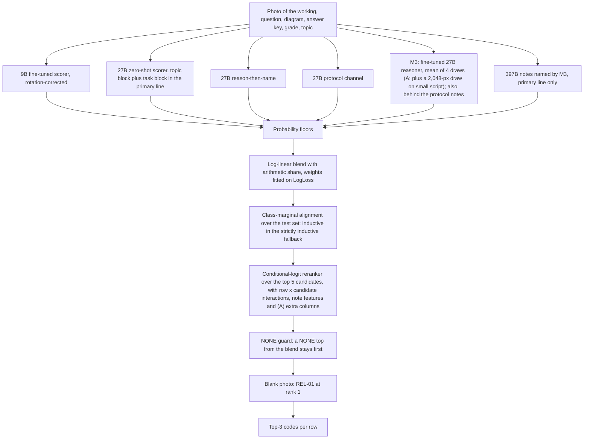

# Misconception Detection in K-12 Student Math Workings: Solution

> **Status:** 2026-11-15 · version 0.4, final submissions selected. This is a living document. The final private-leaderboard
> result will be added after the competition closes (2026-11-17 00:00 UTC). Open work is listed in
> [docs/ROADMAP.md](docs/ROADMAP.md).

**Final submissions** (both from the primary line; chosen by cross-validation, public scores observed afterwards):

| Submission | What it is | Build script | SHA-256 of the file | CV per fold / as one set | Public LB |
|---|---|---|---|---:|---:|
| **Primary submission A** | Five M3 draws (the fifth reads the photo at 2,048 px, only on rows with small script) and nine extra second-stage columns from frozen protocol answers | `tools/builds/primary_m3x5h.sh` | `4505c159…797354e7` | 0.8426 / 0.8404 | 0.84266 |
| **Primary submission B** | Four M3 draws; the fallback of A without its two last components | `tools/builds/primary_m3x4.sh` | `76da786d…a3565f9973` | 0.8436 / 0.8380 | 0.84450 |

The single values are those of the original meta-split; each step was decided over 20 untouched meta-splits (A against
its predecessor with the columns +0.0008 in the mean of both forms, +0.0011 as one set; the columns +0.0017 to +0.0018 on
three sets; the fourth draw +0.0011). Full checksums: [docs/INFERENCE.md](docs/INFERENCE.md#2-lines-and-expected-checksums).

This repository contains the code and documentation of our solution to the Kaggle competition
[Misconception Detection in K-12 Student Math Workings](https://www.kaggle.com/competitions/misconception-detection-in-k-12-student-math-workings),
hosted by CoLearn Lab. Each test row is a photo of a student's handwritten working, together with the question and its answer key. The model
predicts the **root misconception** behind the working: one of 75 taxonomy codes, or `NONE` if the working has no major
error. Up to three codes per row are submitted in order of confidence, and the score is **MAP@3**.

## Summary

- **Several vision-language "channels" read the photo, the question and the answer key.** Each channel returns a full
  probability distribution over the 76 classes. Most channels get it by exact scoring of all 74 classes that occur in
  training, through a prefix tree over the code tokens, so a code gets a probability even if the model would not
  generate it.
- **The strongest channels reason before they name a code.** An open 27B model (Qwen3.8-27B) first writes a diagnosis in
  thinking mode; all codes are then scored behind that text. Our best single model, **M3**, is the same 27B fine-tuned with
  LoRA to write such a diagnosis, followed by the root finding and the code. The mean of three of its generations reaches
  **0.802 MAP@3** out of fold, of four 0.804. The final submissions average four draws, and submission A adds a fifth draw
  that reads the photo at twice the resolution on the rows with small handwriting, where the reading loses most.
- **Channels differ on purpose in what they know.** Some see labelled workings of other students for the same question.
  Others see no labelled row at all and follow a fixed marking protocol. Their errors differ, and the blend gains from
  both kinds.
- **Combination:** a log-linear blend with an arithmetic share, probability floors and weights fitted on LogLoss. The last
  steps are a class-marginal alignment and a small conditional-logit reranker over the top five candidates. If the
  blend puts `NONE` first, the reranker may not replace it (NONE guard), because none of its features measures whether
  the final answer is correct. Row × candidate interactions let row properties such as the blend's uncertainty act
  through the candidates. In the primary line one column marks minor codes in rows whose final answer matches the key
  mechanically; in the safety line the reranker also reads the frozen M3 and protocol-channel notes: how a candidate is
  mentioned there, and how similar the notes are to notes of real assignments of that code in other questions.
- **M3 also names behind the protocol notes.** In the primary candidate the protocol channel's mean channel takes its
  ranking from M3 behind the frozen notes of the protocol answers instead of from the untrained 27B.
- **Extra second-stage columns.** In submission A the reranker also reads nine columns computed on the CPU from the
  frozen protocol answers of our 27B and of the 397B (votes, last-mentioned code, major findings, formed verdicts, the
  mechanical answer check, the answer's own verdict on the final answer) and from the taxonomy sections already seen per
  topic. They were tested together as one bundle against a placebo bundle; a test-side guard per column stops the build if
  a column does not transfer.
- **Two lines, one choice.** The **primary line** maximises cross-validated MAP@3. The **safety line** (no teacher-derived
  input, no API output, no 397B) was kept as a second design until the host confirmed that those techniques are allowed;
  both final submissions now come from the primary line ([docs/DATA_AND_COMPLIANCE.md](docs/DATA_AND_COMPLIANCE.md#6-the-two-lines-and-the-techniques-that-rest-on-interpretation)).
- **Reproducible on the CPU.** Every candidate file is rebuilt byte for byte on the CPU from frozen channel outputs and
  the stored blend and second-stage files. For the files up to version 0.3 this is verified on fresh copies of this
  repository; both final submissions were rebuilt byte for byte on a CPU without network access with the internal code
  version from which version 0.4 was translated, and the same rebuild with this repository is the first open step of
  [docs/ROADMAP.md](docs/ROADMAP.md). The rotation correction of the 9B channel uses the list of the released, seeded
  orientation network, whose weights are stored with the solution.

## How it works



| Channel | Code name | Model | Trained | OOF MAP@3 | Lines |
|---|---|---|---|---:|---|
| 9B fine-tuned scorer (rotation-corrected) | `v1r` | Qwen3.5-9B + LoRA | yes | 0.6474 | both |
| 27B zero-shot scorer with task block | `zs27q` | Qwen3.8-27B (4-bit) | no | 0.6814 | primary |
| 27B zero-shot scorer with topic block | `zs27t` | Qwen3.8-27B (4-bit) | no | 0.6730 | safety |
| 27B reason-then-name | `think18nb` | Qwen3.8-27B | no | 0.7672 | primary |
| 27B reason-then-name, teacher-free | `think18sb` | Qwen3.8-27B | no | 0.7516 | safety |
| 27B protocol channel | `pr27xm` | Qwen3.8-27B | no | 0.7459 | safety; primary fallbacks |
| Protocol channel with the M3 ranking behind its notes | `m3px27xm` | Qwen3.8-27B; Qwen3.8-27B + LoRA (M3) | M3 only | 0.7551 | primary |
| M3: fine-tuned 27B reasoner, mean of 3 draws | `m3x3_full` | Qwen3.8-27B + LoRA | yes | 0.8020 | both (version 0.3) |
| M3, mean of 4 draws | `m3x4_full` | Qwen3.8-27B + LoRA | yes | 0.804 | final submission B |
| M3, 4 draws plus a draw at 2,048 px on the rows with small script | `m3x5h` | Qwen3.8-27B + LoRA | yes | — ⁶ | final submission A |
| 397B notes, named by M3 | `q397m3` | Qwen3.5-397B-A17B + M3 | M3 only | 0.7442 | primary |

⁶ Per row the mean of the draws that cover the row; the fifth draw alone reaches 0.777, the best single draw.

All models in the inference path are open-weight models under the Apache 2.0 licence. A closed model served through a
commercial API acted only as a development-time teacher: it pseudo-labelled the unlabelled pool, never a test row.
Its frozen labels feed the per-question *task block* of the primary line only. The full method is described in
[docs/METHOD.md](docs/METHOD.md).

## Results

Cross-validated values are out-of-fold (OOF) MAP@3 on the 1,500 labelled rows (5 folds, stratified by root code).
*Per fold* applies the last step within each 300-row fold. *As one set* applies it to all 1,500 rows at once, which is how
the test set is processed by the final candidates of both lines. Definitions and uncertainty are in [docs/VALIDATION.md](docs/VALIDATION.md).

| Line and form | Channels | Last steps | CV per fold | CV as one set | Public LB |
|---|---|---|---:|---:|---:|
| **Primary submission A**: five M3 draws (fifth at 2,048 px on small script), extra columns (submitted 2026-11-14) | 6 | alignment over the test set, reranker (73 features), NONE guard | 0.8426 | 0.8404 | 0.84266 |
| Intermediate form: four M3 draws, extra columns (submitted 2026-11-13; not a final submission) | 6 | alignment over the test set, reranker (73 features), NONE guard | 0.8441 | 0.8407 | 0.84283 |
| **Primary submission B**: four M3 draws (submitted 2026-11-08) | 6 | alignment over the test set, reranker (64 features), NONE guard | 0.8436 | 0.8380 | 0.84450 |
| Primary line, final form with the M3 ranking behind the protocol notes (candidate of version 0.3; submitted 2026-11-08) | 6 | alignment over the test set, reranker (64 features), NONE guard | 0.8426 | 0.8382 | 0.84116 |
| Primary line, final form: interactions and minor-code × mechanical-match column (fallback; submitted 2026-11-06) | 6 | alignment over the test set, reranker (64 features), NONE guard | 0.8409 | 0.8398 | 0.84100 |
| Primary line, I1 form: guard form with row × candidate interactions (submitted 2026-11-06) | 6 | alignment over the test set, reranker (63 features), NONE guard | 0.8408 | 0.8387 | 0.84150 |
| Primary line, guard form: reranker main form with NONE guard and general-code identifiers (submitted 2026-11-01) | 6 | alignment over the test set, reranker (48 features), NONE guard | 0.8389 | 0.8377 | 0.84200 |
| Primary line, reranker *main form* (submitted 2026-11-01) | 6 | alignment over the test set, reranker (43 features) | 0.8376 | 0.8346 | 0.84166 |
| **Safety line, reranker with note mentions, example similarity and regex note columns** (current safety candidate; submitted 2026-11-07) | 5 | alignment over the test set, reranker (64 features), NONE guard | 0.8316 | 0.8284 | 0.83716 |
| Safety line, reranker with note mentions and example similarity (fallback; submitted 2026-11-07) | 5 | alignment over the test set, reranker (58 features), NONE guard | 0.8311 | 0.8274 | 0.83750 |
| Safety line, alignment over the test set, reranker with interactions (submitted 2026-11-07) | 5 | alignment over the test set, reranker (55 features), NONE guard | — | 0.8217 | 0.83516 |
| Safety line, strictly inductive form with second stage (fallback; submitted 2026-11-01) | 5 | inductive alignment, reranker (40 features), NONE guard | 0.8233 | — | 0.83183 |
| Safety line, strictly inductive form without second stage (submitted 2026-10-31) | 5 | inductive alignment | 0.8184 | — | 0.82966 |
| Best single model: M3, mean of three draws (OOF) | 1 | none | 0.8020 | — | not submitted |

—: each form of the safety line is evaluated in its own deployment form: the strictly inductive form per fold (fixed
weights per row), the forms with the alignment over the test set as one set (with the gate; the form with interactions
reaches 0.8278 per fold). The two note-feature forms were decided by the mean of both forms and are shown in both; their
gate does not abstain. The single model has no last step.

- **Paired differences** (standard error from a bootstrap over questions; ½(F+M) is the mean of the per-fold and the
  as-one-set difference):
  - fifth M3 draw (photo at 2,048 px, rows with character height ≤ 20 px) over the intermediate form: over 20 untouched
    meta-splits ½(F+M) +0.00083 ± 0.00017, as one set +0.00108 ± 0.00030; original meta-split −0.0009 / −0.0002; the best
    copy null point (one 1,024-px draw twice) reaches +0.0009, so the gain is that of one more useful draw;
  - nine extra second-stage columns over submission B: ½(F+M) +0.00169 ± 0.00015, +0.00177 ± 0.00025 and +0.00178 ± 0.00025
    on three disjoint sets of 20 untouched meta-splits (placebo bundle −0.00044); original +0.0016 (as one set +0.0027);
  - fourth M3 draw over three (submission B over the version-0.3 candidate): fair bank over 20 meta-splits +0.00109 ±
    0.00015 (20 of 20 positive), copy null point −0.00036; on 20 further meta-splits +0.00137;
  - M3 ranking behind the protocol notes in the mean channel, over the final form with `pr27xm`: ½(F+M) +0.0001 on the
    original meta-split (per fold +0.0017, as one set −0.0016); over 20 new meta-splits +0.0001 ± 0.0002, above the mean of
    four controls of the same role (−0.0005); without the 397B channel +0.0019, over 20 new meta-splits +0.0010 ± 0.0002;
  - regex note columns in the safety line, over the form with note mentions and example similarity: ½(F+M) +0.0007 ± 0.0011
    against a placebo mean of −0.0001; full draw swap over four M3 draw sets +0.0006, positive in 4 of 4; over 20 new
    meta-splits +0.0009 ± 0.0002;
  - note mentions and example similarity in the safety line, over the form with interactions: ½(F+M) +0.0032 ± 0.0015
    against a placebo mean of +0.0005; over 20 new meta-splits +0.0028 ± 0.0002, positive in 20 of 20; risk rule
    P(θ < −0.002) = 0.0001;
  - minor-code × mechanical-match column over the I1 form: ½(F+M) +0.0006; over 20 new meta-splits +0.0005 ± 0.0001,
    positive in 19 of 20;
  - row × candidate interactions over the guard form: ½(F+M) +0.0014; over 20 new meta-splits +0.0011 ± 0.0002,
    positive in 18 of 20;
  - NONE guard and general-code identifiers over the main form: +0.0013 ± 0.0014 per fold, +0.0031 ± 0.0015 as one set;
  - safety line, alignment over the test set (variant a, without interactions) over the strictly inductive form: over 20
    new meta-splits +0.0007 ± 0.0002, positive in 16 of 20; the interactions add +0.0007 ± 0.0001. On the original
    meta-split the pre-registered CV condition was missed by one sixth in 9,000 and overridden by a recorded decision
    ([decisions/override_cv_condition_ii.json](decisions/override_cv_condition_ii.json)); the test-side class masses after
    the alignment lie at L1 0.028 from the target, against 0.087 with the inductive alignment;
  - second stage with NONE guard in the strictly inductive form: +0.0049 ± 0.0022 per fold. Its gain depends on the
    generated M3 texts; on the test side, whose M3 texts are independent draws, +0.002 to +0.003 is expected.
- All files since 2026-11-01 use the rotation list of the released orientation network; the two files of 2026-10-31 used
  the list of a first, unseeded run. Rebuilt with the released list, the reranker fallback form changes the top code of
  one test row and the strictly inductive form of none.
- Public leaderboard values are observations, not selection criteria. The public split has 1,000 of the 3,498 test rows,
  and differences of about ±0.003 to ±0.005 between consecutive submissions are within its paired noise. The private
  split (2,498 rows) decides the competition.
- The step-by-step progression, ablations and error analysis are in [docs/RESULTS.md](docs/RESULTS.md).
- Final scores: *to be added after the competition closes.*

## Repository layout

```
k12-solution/
├── README.md · LICENSE · THIRD_PARTY.md · CHANGELOG.md
├── docs/                  method, validation, results, training, inference, data & compliance, code map, roadmap
├── configs/
│   ├── folds.parquet      the fixed 5-fold split (row position → fold; hash-checked)
│   └── vlm/               one YAML file per model run (training, OOF and test-side jobs)
├── src/                   metric, label space, submission checks, transcription cleaning, second stage, answer matching,
│                          note similarity and regex note features, orientation net
│   └── vlm/               model runner: prompts, exact code scoring, LoRA training, vLLM text generation
├── decisions/             recorded decisions that a build script checks by their pinned checksum
├── kaggle_core/           small shared library: artifacts, folds, metrics, submission validation
├── eda/                   step scripts: OOF assembly, blend fitting, deployment checks, second stages
├── tools/
│   ├── make_submission.py assembly of a submission from frozen channel outputs
│   ├── builds/            one build script per submitted or candidate file, plus the rotation-list helper
│   ├── replay/gates.py    reconstruction and check of the gate lists of the reasoning channels
│   └── …                  fold array, rotation lists and their checks, frozen M3 texts, 397B notes; API clients (development only)
└── tests/                 unit and regression tests
```

Neither the competition data nor anything derived from it per row is part of this repository, except the fold
assignment by row position (`configs/folds.parquet`, no identifier and no label). The excluded files are
transcriptions, model texts, pseudo-labels, OOF matrices, frozen test outputs, submissions and trained weights; they are
kept privately and referenced by path and, where pinned, by SHA-256
(see [docs/DATA_AND_COMPLIANCE.md](docs/DATA_AND_COMPLIANCE.md)).
[docs/CODEMAP.md](docs/CODEMAP.md) maps every script to its role. Some file and script names carry historical build
labels such as `s029`, `s030n`, `s034` or `s035`; they are kept because the frozen artifacts and their checksums refer to
them. The build scripts added in versions 0.2–0.4, their deployment files and output files are named by role:
`primary_i1`, `primary_final`, `safety_final` (version 0.2), `safety_nd`, `safety_ndr`, `primary_m3px27` (version 0.3) and
`primary_m3x4` (submission B), `primary_cols` (intermediate form), `primary_m3x5h` (submission A) (version 0.4).

## Quick start

The solution can be reproduced at three depths:

| Mode | What is recomputed | Expected result | Hardware |
|---|---|---|---|
| `assemble` | Blend, alignment, reranker and output file, from frozen channel outputs | Byte-identical to the submitted file | CPU, minutes |
| `rescore` | Every scoring and ranking step on all test images, behind the frozen reasoning texts and gates | Identical on the reference hardware; statistically equivalent on other hardware | GPUs: about 10 h on a 96 GB card plus A40 and Kaggle T4 time, and 4×H200 for the 397B parity check (preliminary estimate from before the 397B channel and the second stages) |
| `full` | Everything from images and CSV files, including new reasoning texts | Statistically equivalent: each generated text is a new draw | GPUs: about 30 h on a 96 GB card plus A40 and Kaggle T4 time, and 4×H200 for the 397B notes (preliminary estimate from before the 397B channel and the second stages) |

**Assemble (CPU).** Put the competition data under `data/`. The private inputs, which are available to the competition
host for verification but are not public, go under `data/derived/` (frozen derived inputs such as gate lists, rotation
lists and notes) and under `artifacts/` (frozen channel outputs, OOF matrices, blend and second-stage files, the
description of the orientation network, and earlier submission files that the build scripts use as references); see
[docs/INFERENCE.md](docs/INFERENCE.md#3-data-layout). The private copies of these inputs are being brought to the state
of this version ([docs/ROADMAP.md](docs/ROADMAP.md), step 3). Then:

```bash
# Python 3.13 with the CPU versions listed in docs/INFERENCE.md (section 4)
export OPENBLAS_NUM_THREADS=2 OMP_NUM_THREADS=2
python -I tools/make_folds.py                              # artifacts/folds.npy from configs/folds.parquet
ORIENT=legacy bash tools/builds/s029_m3x3.sh safe          # earlier files with the first-version rotation list,
ORIENT=legacy bash tools/builds/s034_stage2_main.sh best   #   used as references by the builds below
bash tools/builds/safety_ndr.sh       # safety line, final candidate (runs safety_nd.sh, which runs safety_final.sh and primary_final.sh first)
bash tools/builds/primary_m3px27.sh   # primary candidate of version 0.3 (runs primary_final.sh first)
bash tools/builds/primary_m3x5h.sh    # the two final submissions: runs primary_cols.sh, which runs primary_m3x4.sh
sha256sum artifacts/submissions/sub_primary_m3x5h.csv artifacts/submissions/sub_primary_m3x4.csv
#   4505c15950167650…  sub_primary_m3x5h.csv  (primary submission A)
#   76da786dfdbe6a6d…  sub_primary_m3x4.csv   (primary submission B)
```

On the first run with the code of this version the three new build scripts print the checksums of the JSON files they
write themselves ("FIRST BUILD"); the checksums of the CSV files and test matrices are checked on every run
([docs/INFERENCE.md](docs/INFERENCE.md#2-lines-and-expected-checksums)).

The expected checksums of these files and of their fallbacks are in [docs/INFERENCE.md](docs/INFERENCE.md#2-lines-and-expected-checksums).
The build scripts use the rotation list of the released orientation network by default (`ORIENT=repro`); `ORIENT=legacy`
only rebuilds the earlier files. The safety chain contains `safety_final.sh`, which `safety_nd.sh` runs with
`OVERRIDE_CV_II=override_cv_condition_ii`: this applies the recorded decision
[decisions/override_cv_condition_ii.json](decisions/override_cv_condition_ii.json) (checked by its pinned checksum), which
overrides only the cross-validation part of one condition of that form's pre-registered rule; run on its own without the
switch, `safety_final.sh` stops after that rule with exit code 5. `primary_m3px27.sh` checks the files of `safety_nd.sh`
and `safety_ndr.sh` by their checksums, so the safety build runs first. A single entry point per line that does not need
the chain of earlier builds is planned ([docs/ROADMAP.md](docs/ROADMAP.md)). `rescore` and `full` run the model steps listed in [docs/INFERENCE.md](docs/INFERENCE.md).
Training of every component is described in [docs/TRAINING.md](docs/TRAINING.md). The unit and regression tests run with
`python -m pytest tests -q`; tests that need private files skip themselves.

## Status and next steps

- The two final submissions are selected (2026-11-15). Both were rebuilt byte for byte on a Kaggle CPU without network
  access from the frozen inputs, with the internal code version from which this repository was translated.
- Open: the first build of both files with the code of this repository (it learns the checksums of the regenerated JSON
  files; the CSV checksums are pinned); smoke tests without network access for the GPU model steps, including the 397B
  path; private copies of the inputs in the state of this version, including the M3 training targets; an estimate of the
  rerun variance of the generated texts.
- Details: [docs/ROADMAP.md](docs/ROADMAP.md).

## Documentation

| Document | Content |
|---|---|
| [docs/METHOD.md](docs/METHOD.md) | Data, channels, prompts and protocols, training, teacher pseudo-labels, orientation network and rotation list, blend, alignment, second stages with NONE guard, the two lines |
| [docs/VALIDATION.md](docs/VALIDATION.md) | Folds, measurement forms, paired uncertainty, decision rules, controls, checks of the second-stage components, risk rule of the inductive line, checks before a submission |
| [docs/RESULTS.md](docs/RESULTS.md) | Progression, submissions, single-channel values, ablations and null results, error analysis, compute |
| [docs/TRAINING.md](docs/TRAINING.md) | Every trained or fitted component: inputs and their provenance, command, hardware, duration, expected checks; what a retraining gives |
| [docs/INFERENCE.md](docs/INFERENCE.md) | The modes `assemble`, `rescore` and `full`: commands, hardware, run times, expected checksums; running on a new test set; recomputing the 397B channel |
| [docs/DATA_AND_COMPLIANCE.md](docs/DATA_AND_COMPLIANCE.md) | What data lives where, API use, host statements, offline inference, test-data policy, licences |
| [docs/PROVENANCE.md](docs/PROVENANCE.md) | Every frozen input of the two final submissions: producer, configuration, network status, determinism; the training chain |
| [docs/MODEL_SIZES.md](docs/MODEL_SIZES.md), [docs/weights_manifest.json](docs/weights_manifest.json) | Parameters and bytes of every model against the host's limits; file list with checksums of the base models and our weights |
| [docs/CODEMAP.md](docs/CODEMAP.md) | Index of scripts and modules, channel names, data formats |
| [docs/ROADMAP.md](docs/ROADMAP.md) | Current status and open steps |
| [THIRD_PARTY.md](THIRD_PARTY.md) | Models, services and packages with licences |
| [CHANGELOG.md](CHANGELOG.md) | Versions of this repository |

## License

Our own code and documentation are released under the [Apache License 2.0](LICENSE). Models, packages and services by
third parties keep their own licences; see [THIRD_PARTY.md](THIRD_PARTY.md). The competition data are subject to the
competition rules and are not distributed here.

## Acknowledgements

We thank CoLearn Lab for hosting the competition and providing the data, and the Qwen team for releasing the open models
this solution is built on.
