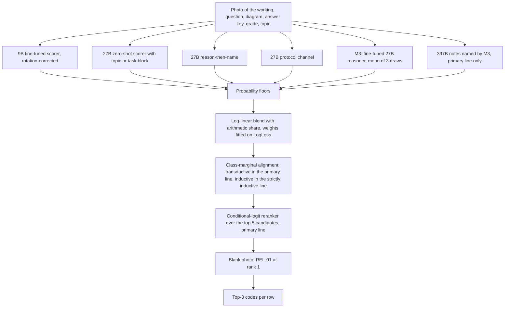

# Misconception Detection in K-12 Student Math Workings: Solution

> **Status:** 2026-11-01 · version 0, pre-final. This is a living document. The final private-leaderboard result will be
> added after the competition closes (2026-11-17 00:00 UTC). Open work is listed in [docs/ROADMAP.md](docs/ROADMAP.md).

This repository contains the code and documentation of our solution to the Kaggle competition
[Misconception Detection in K-12 Student Math Workings](https://www.kaggle.com/competitions/misconception-detection-in-k-12-student-math-workings),
hosted by CoLearn Lab. Each test row is a photo of a student's handwritten working, together with the question and its answer key. The model
predicts the **root misconception** behind the working: one of 75 taxonomy codes, or `NONE` if the working has no major
error. Up to three codes per row are submitted in order of confidence, and the score is **MAP@3**.

## Summary

- **Several vision-language "channels" read the photo, the question and the answer key.** Each channel returns a full
  probability distribution over the 76 classes. To get it, the model scores every taxonomy code exactly through a prefix
  tree over the code tokens. A code therefore gets a probability even if the model would not generate it.
- **The strongest channels reason before they name a code.** An open 27B model (Qwen3.8-27B) first writes a diagnosis in
  thinking mode; all codes are then scored behind that text. Our best single model, **M3**, is the same 27B fine-tuned with
  LoRA to write such a diagnosis, followed by the root finding and the code. The mean of three of its generations reaches
  **0.802 MAP@3** out of fold.
- **Channels differ on purpose in what they know.** Some see labelled workings of other students for the same question.
  Others see no labelled row at all and follow a fixed marking protocol. Their errors overlap little, and the blend gains
  from both kinds.
- **Combination:** a log-linear blend with an arithmetic share, probability floors and weights fitted on LogLoss. The last
  steps are a class-marginal alignment and a small conditional-logit reranker over the top five candidates.
- **Two lines.** The **primary line** maximises cross-validated MAP@3. The **strictly inductive line** uses no input
  derived from the development-time teacher model and no transductive step. The two final submissions are drawn from
  these two lines.

## Results

Cross-validated values are out-of-fold (OOF) MAP@3 on the 1,500 labelled rows (5 folds, stratified by root code).
*Per fold* applies the last step within each 300-row fold. *As one set* applies it to all 1,500 rows at once, which is how
the test set is processed. Definitions and uncertainty are in [docs/VALIDATION.md](docs/VALIDATION.md).

| Line | Channels | Last steps | CV per fold | CV as one set | Public LB |
|---|---|---|---:|---:|---:|
| Primary line, reranker *fallback form* (submitted 2026-10-31) | 6 | transductive alignment, reranker (40 features) | 0.8356 | 0.8338 | 0.84033 |
| Primary line, reranker *main form* (candidate) | 6 | transductive alignment, reranker (43 features) | 0.8376 | 0.8346 | not submitted |
| Strictly inductive line (submitted 2026-10-31) | 5 | inductive alignment | 0.8184 | not applicable | 0.82966 |
| Best single model: M3, mean of three draws (OOF) | 1 | none | 0.8020 | not applicable | not submitted |

- Public leaderboard values are observations, not selection criteria. The public split has 1,000 of the 3,498 test rows,
  and differences of about ±0.005 between consecutive submissions are within its noise. The private split (2,498 rows)
  decides the competition.
- The step-by-step progression, ablations and error analysis are in [docs/RESULTS.md](docs/RESULTS.md).
- Final scores: *to be added after the competition closes.*

## How it works



| Channel | Code name | Model | Trained | OOF MAP@3 | Lines |
|---|---|---|---|---:|---|
| 9B fine-tuned scorer (rotation-corrected) | `v1r` | Qwen3.5-9B + LoRA | yes | 0.6474 | both |
| 27B zero-shot scorer with task block | `zs27q` | Qwen3.8-27B (4-bit) | no | 0.6814 | primary |
| 27B zero-shot scorer with topic block | `zs27t` | Qwen3.8-27B (4-bit) | no | 0.6730 | inductive |
| 27B reason-then-name | `think18nb` | Qwen3.8-27B | no | 0.7672 | primary |
| 27B reason-then-name, teacher-free | `think18sb` | Qwen3.8-27B | no | 0.7516 | inductive |
| 27B protocol channel | `pr27xm` | Qwen3.8-27B | no | 0.7459 | both |
| M3: fine-tuned 27B reasoner, mean of 3 draws | `m3x3_full` | Qwen3.8-27B + LoRA | yes | 0.8020 | both |
| 397B notes, named by M3 | `q397m3` | Qwen3.5-397B-A17B + M3 | M3 only | 0.7442 | primary |

All models in the inference path are open-weight models under the Apache 2.0 licence. A closed model served through a
commercial API acted only as a development-time teacher: it pseudo-labelled the unlabelled pool, never a test row.
Its frozen labels feed the per-question *task block* of the primary line only. The full method is described in
[docs/METHOD.md](docs/METHOD.md).

## Repository layout

```
k12-solution/
├── README.md · LICENSE · THIRD_PARTY.md · CHANGELOG.md
├── docs/                  method, validation, results, training, inference, data & compliance, code map, roadmap
├── configs/
│   ├── base.yaml          shared settings (cross-validation, labels, paths)
│   ├── folds.parquet      the fixed 5-fold split (row position → fold; hash-checked)
│   ├── lines/             line definitions for assembly (in preparation)
│   └── vlm/               one YAML file per model run (training, OOF and test-side jobs)
├── src/                   metric, label space, submission checks, transcription cleaning, second stage, orientation net
│   └── vlm/               model runner: prompts, exact code scoring, LoRA training, vLLM text generation
├── kaggle_core/           small shared library: artifacts, folds, metrics, submission validation
├── eda/                   step scripts: OOF assembly, blend fitting, deployment checks, second stage, gates
├── tools/
│   ├── make_submission.py assembly of a submission from frozen channel outputs
│   ├── builds/            one build script per submitted file
│   ├── replay/            manifests of frozen inputs, gate reconstruction, environment locks, dependency traces
│   └── …                  helpers for notes, training targets, orientation lists, blank photos; API clients (development only)
├── kernels/               offline wheelhouse builder; optional Kaggle T4 path
├── solution/              environment locks and manifests (frozen inputs, weights, submissions)
└── tests/                 unit and regression tests
```

Neither the competition data nor anything derived from it per row is part of this repository. That covers transcriptions,
model texts, pseudo-labels, OOF matrices, frozen test outputs, submissions and trained weights. These files are kept
privately and referenced by path and SHA-256 (see [docs/DATA_AND_COMPLIANCE.md](docs/DATA_AND_COMPLIANCE.md)).
[docs/CODEMAP.md](docs/CODEMAP.md) maps every script to its role. Some file and script names carry historical build
labels such as `s029` or `s034`; they are kept because the frozen artifacts and their checksums refer to them.

## Quick start

The solution can be reproduced at three depths:

| Mode | What is recomputed | Expected result | Hardware |
|---|---|---|---|
| `assemble` | Blend, alignment, reranker and output file, from frozen channel outputs | Byte-identical to the submitted file | CPU, minutes |
| `rescore` | Every scoring and ranking step on all test images, behind the frozen reasoning texts and gates | Identical on the reference hardware; statistically equivalent on other hardware | GPUs, about 10 h on a 96 GB card plus A40 and Kaggle T4 time (preliminary estimate) |
| `full` | Everything from images and CSV files, including new reasoning texts | Statistically equivalent: each generated text is a new draw | GPUs, about 30 h on a 96 GB card plus A40 and Kaggle T4 time (preliminary estimate) |

**Assemble (CPU).** Put the competition data under `data/`. The private inputs go under `data/derived/` (frozen derived
inputs such as gate lists and notes) and under `artifacts/` (frozen channel outputs, OOF matrices, blend and second-stage
files); see [docs/INFERENCE.md](docs/INFERENCE.md#3-data-layout). Then:

```bash
# Python 3.13 with the versions pinned in solution/env/cpu.lock
bash tools/builds/s029_m3x3.sh safe          # strictly inductive line
bash tools/builds/s032_stage2.sh best        # primary line, reranker fallback form
bash tools/builds/s034_stage2_main.sh best   # primary line, reranker main form
sha256sum artifacts/submissions/*.csv        # compare with docs/INFERENCE.md
```

A single entry point, `tools/replay/assemble.py --line <line>`, is in preparation. It reads the line definitions in
`configs/lines/` and checks every input checksum. `rescore` and `full` run the model steps listed in
[docs/INFERENCE.md](docs/INFERENCE.md). Training of every component is described in [docs/TRAINING.md](docs/TRAINING.md).

## Documentation

| Document | Content |
|---|---|
| [docs/METHOD.md](docs/METHOD.md) | Data, channels, prompts and protocols, training, teacher pseudo-labels, orientation network, blend, alignment, second stage, the two lines |
| [docs/VALIDATION.md](docs/VALIDATION.md) | Folds, measurement forms, paired uncertainty, decision rules, controls, checks before a submission |
| [docs/RESULTS.md](docs/RESULTS.md) | Progression, submissions, single-channel values, ablations and null results, error analysis, compute |
| [docs/TRAINING.md](docs/TRAINING.md) | Every trained or fitted component: inputs, command, hardware, duration, expected checks |
| [docs/INFERENCE.md](docs/INFERENCE.md) | The modes `assemble`, `rescore` and `full`: commands, hardware, run times, expected checksums |
| [docs/DATA_AND_COMPLIANCE.md](docs/DATA_AND_COMPLIANCE.md) | What data lives where, API use, offline inference, test-data policy, licences |
| [docs/CODEMAP.md](docs/CODEMAP.md) | Index of scripts and modules, channel names, data formats |
| [docs/ROADMAP.md](docs/ROADMAP.md) | Current status and remaining steps up to the final submission |
| [THIRD_PARTY.md](THIRD_PARTY.md) | Models, services and packages with licences |
| [CHANGELOG.md](CHANGELOG.md) | Versions of this repository |

## License

Our own code and documentation are released under the [Apache License 2.0](LICENSE). Models, packages and services by
third parties keep their own licences; see [THIRD_PARTY.md](THIRD_PARTY.md). The competition data are subject to the
competition rules and are not distributed here.

## Acknowledgements

We thank CoLearn Lab for hosting the competition and providing the data, and the Qwen team for releasing the open models
this solution is built on.
